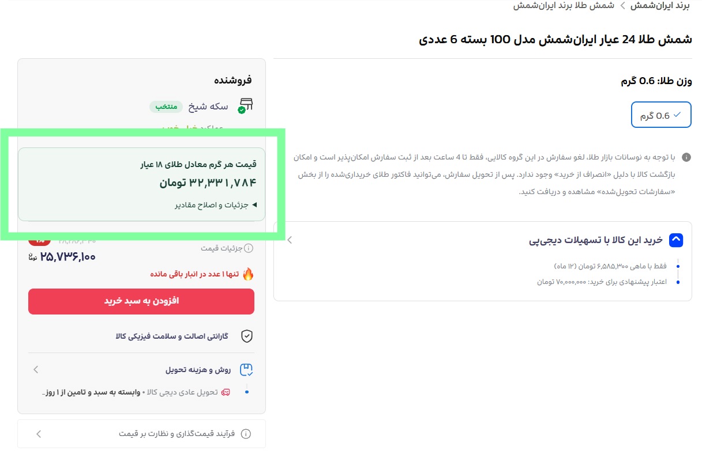

# قیمت واقعی طلا در دیجی‌کالا

وقتی در دیجی‌کالا طلا می‌خریم، قیمت نهایی محصول همیشه به ما نمی‌گوید که **هر گرم طلا برایمان چند حساب شده است**. تفاوت وزن، عیار و تعداد قطعات در بسته هم مقایسهٔ محصولات را سخت‌تر می‌کند.

این افزونه کمک می‌کند هنگام دیدن یک محصول، قیمت هر گرم طلای آن را همان‌جا ببینید. قیمت خرید، وزن طلا و عیار محصول به یک مبنای مشترک، یعنی **هر گرم طلای ۱۸ عیار (۷۵۰)**، تبدیل می‌شوند تا بتوانید پیشنهادهای خرید را راحت‌تر مقایسه کنید.

منظور از «قیمت واقعی» در این افزونه، مبلغی است که با قیمت درج‌شدهٔ محصول، به‌ازای هر گرم طلای معادل ۱۸ عیار می‌پردازید. قیمت روز بازار به‌صورت خودکار دریافت نمی‌شود.

## امکانات

- نمایش قیمت هر گرم طلای معادل ۱۸ عیار در بخش خرید محصول، به تومان.
- به‌روزرسانی نتیجه با تغییر قیمت یا مشخصات تشخیص‌داده‌شدهٔ محصول.
- پشتیبانی از شمش، سکه و زیورآلات طلا با عیارهای ۷۵۰، ۹۰۰، ۹۹۵ و ۹۹۹.
- نمایش جزئیات محاسبه و امکان اصلاح دستی قیمت، وزن و عیار.
- رابط فارسی و اجرای محاسبات در مرورگر، بدون ارسال اطلاعات به سرور.

## نمونهٔ نمایش افزونه

## نصب

1. در کروم نشانی `chrome://extensions` و در اج نشانی `edge://extensions` را باز کنید.
2. حالت توسعه‌دهنده (**Developer mode**) را فعال کنید.
3. گزینهٔ بارگذاری افزونهٔ بسته‌بندی‌نشده (**Load unpacked**) را انتخاب و پوشهٔ همین پروژه، یعنی پوشهٔ حاوی `manifest.json`، را مشخص کنید.
4. برگه‌های باز دیجی‌کالا را دوباره بارگذاری کنید.

برای استفاده از افزونه، نیازی به ساخت پروژه یا نصب وابستگی‌ها با `npm` نیست.

## روش استفاده

1. صفحهٔ یک محصول طلا را در دیجی‌کالا باز کنید.
2. کادر «قیمت هر گرم معادل طلای ۱۸ عیار» را در بخش خرید ببینید؛ در صورت تشخیص محل قیمت، کادر بالای آن قرار می‌گیرد.
3. برای بررسی اطلاعات مبنای محاسبه، «جزئیات و اصلاح مقادیر» را باز کنید.
4. اگر قیمت، وزن یا عیار نامشخص یا متناقض بود، مقدار درست را دستی وارد کنید. برای زیورآلات دارای سنگ، وزن خود طلا را وارد کنید.

مقادیر دستی با برچسب مشخص می‌شوند و با گزینهٔ «بازنشانی» قابل پاک‌کردن هستند. بارگذاری دوبارهٔ صفحه یا تغییر فروشنده، گونهٔ محصول، وزن، عیار یا قیمت خرید تشخیص‌داده‌شده نیز این مقادیر را پاک می‌کند.

محاسبه فقط در صفحهٔ هر محصول نمایش داده می‌شود؛ صفحات جست‌وجو، فهرست دسته‌بندی‌ها و کارت‌های پیشنهاد محصول کادر محاسبه ندارند.

## نتیجه چگونه محاسبه می‌شود؟

قیمت هر گرم طلای ۷۵۰ از این فرمول به دست می‌آید:

`قیمت خرید به تومان × ۷۵۰ ÷ (وزن کل طلا به گرم × عیار)`

برای مثال، شمش یک‌گرمی با عیار ۹۹۹ و قیمت ۱٬۰۰۰٬۰۰۰ تومان، تقریباً **۷۵۰٬۷۵۱ تومان به‌ازای هر گرم طلای ۷۵۰** محاسبه می‌شود. تمام هزینه‌های لحاظ‌شده در قیمت خرید در این محاسبه حضور دارند. نتیجه، نرخ مؤثر خرید است و ارزش روز طلای محصول را نشان نمی‌دهد. هزینهٔ ارسال و تخفیف‌های مشروط به مبلغ اضافه نمی‌شوند.

محصولات طلایی در دسته‌های مختلف، از جمله شمش، سکه، انگشتر، گردنبند، دستبند، گوشواره، آویز و سرویس طلا پشتیبانی می‌شوند. محصولات صرفاً طلایی‌رنگ، نقره، روکش طلا یا بدلی کنار گذاشته می‌شوند. محاسبه به وزن مشخص طلا و یکی از عیارهای ۷۵۰، ۹۰۰، ۹۹۵ یا ۹۹۹ نیاز دارد؛ مقادیر نامشخص یا متناقض را می‌توان دستی وارد کرد. عبارت صریح «۱۸ عیار» معادل عیار ۷۵۰ است؛ عبارت «۲۴ عیار» به‌تنهایی برای تشخیص عیار ۹۹۵ از ۹۹۹ کافی نیست و باید قاعدهٔ برند مربوط نیز مشخص باشد. واحدهای گرم، کیلوگرم، میلی‌گرم و سوت (یک‌هزارم گرم) پشتیبانی می‌شوند. تعداد صریح بسته در وزن هر شمش ضرب می‌شود. برای زیورآلات دارای سنگ یا مواد دیگر، باید وزن طلا را به کار برد؛ اگر این وزن مشخص نیست، آن را دستی وارد کنید.

عنوان **«وزن طلا: … گرم»** برای گونهٔ انتخاب‌شدهٔ محصول، وزن کل طلای کالای عرضه‌شده را تعیین می‌کند؛ حتی اگر خارج از جدول مشخصات باشد. این وزن برای بسته‌های چندتایی مستقیماً استفاده می‌شود. در نمونهٔ ذخیره‌شدهٔ ایران‌شمش، «وزن طلا: ۰٫۶ گرم» یعنی **۰٫۶ گرم برای کل بستهٔ شش‌عددی**، نه ۳٫۶ گرم. اگر عنوان محصول وزن هر شمش را جداگانه ذکر کند، حاصل ضرب آن در تعداد بسته باید با وزن کل سازگار باشد؛ تناقض همچنان مانع محاسبه می‌شود. گزینه‌های وزن انتخاب‌نشده و کارت‌های پیشنهاد محصول کنار گذاشته می‌شوند. تغییر وزن انتخاب‌شده، محاسبه را به‌روز و مقادیر دستی را پاک می‌کند.

### قواعد تشخیص عیار

قواعد زیر بر اساس عنوان محصول و، برای سکه‌های بانک مرکزی، مشخصات آن اعمال می‌شوند:

| نشانهٔ تشخیص محصول | عیار |
| --- | --- |
| سکه با ذکر «بانک مرکزی» در عنوان یا مشخصات | ۹۰۰ |
| ایران شمش / ایران‌شمش / ایرانشمش، ۲۴ عیار | ۹۹۵ |
| پارسیس، ۲۴ عیار | ۹۹۹ |
| زیوتو پلاس، ۲۴ عیار (شامل نگارش چسبیده یا با نیم‌فاصله) | ۹۹۹ |
| زیوتو، ۲۴ عیار (به‌جز زیوتو پلاس) | ۹۹۵ |
| پلاکو | ۷۵۰ |
| 18 / ۱۸ / ١٨ (شامل «۱۸ عیار» و «۱۸ غیار») | ۷۵۰ |
| طلای محمد، ۲۴ عیار | ۹۹۵ |

سکه‌های بانک مرکزی با عیار ۹۰۰ محاسبه می‌شوند؛ برای تشخیص خودکار، عنوان باید شامل «سکه» باشد و عبارت «بانک مرکزی» در عنوان یا مشخصات آمده باشد. این قاعده به همهٔ سکه‌ها تعمیم داده نمی‌شود و سکه‌های طلای ۱۸ عیار همچنان با عیار ۷۵۰ محاسبه می‌شوند. عیار ۹۰۰ را می‌توان دستی نیز انتخاب کرد. اگر عیار صریح با قاعدهٔ بانک مرکزی تناقض داشته باشد، محاسبهٔ خودکار متوقف می‌شود تا مقدار درست دستی وارد شود.

قاعدهٔ زیوتو پلاس بر قاعدهٔ زیوتو ۲۴ عیار اولویت دارد. عنوان‌هایی که صریحاً ۱۸ عیار را ذکر می‌کنند از عیار ۷۵۰ استفاده می‌کنند. عنوان‌هایی که قبلاً تنها با نام برند پشتیبانی می‌شدند، در نبود عبارت صریح ۱۸ عیار، همچنان از مقدار پیش‌فرض همان برند استفاده می‌کنند. تناقض بین مقادیر عددی صریح در عنوان و مشخصات، محاسبهٔ خودکار را متوقف می‌کند و با ورود دستی مقدار درست قابل رفع است.

## توسعه و بررسی صحت

برای بررسی محاسبات و هماهنگی با ساختار صفحه، دستورهای `npm ci`، سپس `npm test` و `npm run check` را اجرا کنید. آزمون‌ها قواعد عیار از جمله سکهٔ بانک مرکزی با عیار ۹۰۰، تشخیص زیورآلات طلا، تغییر فروشنده، ورود دستی، تبدیل واحد، قیمت‌های متناقض، جابه‌جایی میان صفحات محصول و نبود کادر محاسبه در فهرست‌ها را پوشش می‌دهند. هر دو صفحهٔ ذخیره‌شده در `sample/` بازآزمایی می‌شوند: بستهٔ شش‌عددی ایران‌شمش با وزن ۰٫۶ گرم و عیار ۹۹۵ و سکهٔ ۱۸ عیار ماربر با وزن ۰٫۰۳ گرم و عیار ۷۵۰. قیمت و وزن محصولات پیشنهادی وارد این محاسبات نمی‌شوند.

نتیجهٔ نمونه‌های ذخیره‌شده:

| محصول | قیمت خرید (تومان) | قیمت هر گرم معادل طلای ۷۵۰ (تومان) |
| --- | --- | --- |
| بستهٔ شش‌عددی ایران‌شمش | ۲۶٬۰۷۸٬۰۰۰ | ۳۲٬۷۶۱٬۳۰۷ |
| سکهٔ ماربر | ۹۰۶٬۲۸۰ | ۳۰٬۲۰۹٬۳۳۳ |

## محدودیت‌ها

**بررسی مستقیم در وب‌سایت دیجی‌کالا همچنان لازم است.** استخراج اطلاعات و نمایش نتیجه با دو صفحهٔ ذخیره‌شده بررسی شده‌اند؛ بررسی زندهٔ سایت هنوز انجام نشده است. کد `src/digikala.js` نشانه‌های قیمت، وزن طلای انتخاب‌شده و ساختارهای رایج بخش خرید و مشخصات را تشخیص می‌دهد. تغییر چیدمان دیجی‌کالا ممکن است مانع استخراج اطلاعات یا جای‌گذاری کادر شود.

افزونه مقادیر نامشخص یا متناقض را اعلام می‌کند تا بتوانید آن‌ها را دستی اصلاح کنید. اگر بخش اصلی خرید شناسایی نشود، وجود قیمت‌های متناقض در صفحه مانع محاسبه می‌شود. اسکریپت‌ها برای پشتیبانی از جابه‌جایی بدون بارگذاری کامل، در سراسر دیجی‌کالا ثبت شده‌اند؛ استخراج اطلاعات و نمایش نتیجه فقط در مسیرهای `/product/` انجام می‌شود.

برای بررسی اولیه در سایت، یک شمش با عیار ۹۹۹، یک شمش با عیار ۹۹۵، یک بستهٔ چندتایی و یک محصول با مشخصات ناقص را امتحان کنید. تغییر فروشنده یا گونهٔ محصول و جابه‌جایی میان صفحات جست‌وجو و محصول را نیز بررسی کنید. مقادیر مبنای محاسبه را با پیشنهاد خرید قابل مشاهده تطبیق دهید و مطمئن شوید صفحات جست‌وجو و دسته‌بندی کادر محاسبه ندارند. مشخصاتی که فقط پس از باز کردن برگهٔ مشخصات بارگذاری می‌شوند، پس از باز کردن همان برگه در دسترس افزونه قرار می‌گیرند.

## حریم خصوصی

افزونه سرور پشتیبان، ذخیره‌سازی، تحلیل رفتار کاربر، اسکریپت خارجی یا مجوز اضافی برای دسترسی به رابط‌های برنامه‌نویسی ندارد. اسکریپت‌ها فقط در صفحات امن دیجی‌کالا با پروتکل `HTTPS` اجرا می‌شوند. تمام ورودی‌های دستی در حافظهٔ همان صفحه باقی می‌مانند و درخواست شبکه‌ای ارسال نمی‌شود.
